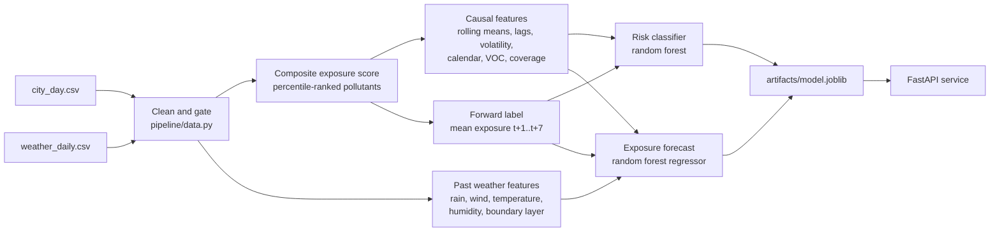

# Exposure-Aware Air Quality Health Risk Forecasting

Forecasting next-week air-pollution health risk (**Low / Moderate / High**) for
18 Indian cities from daily multi-pollutant measurements and weather
(2015–2020). The models are served through a **FastAPI** service and packaged
with **Docker**.

> **Headline:** 75.1% accuracy / **0.756 macro F1** on a held-out future
> period. That is **+0.018 macro F1 over a one-line persistence rule**
> ("next week looks like this week"). Adding daily weather does not improve
> the risk classes, but it powers a separate **next-week exposure forecast**
> that cuts error by **11%** against "no change". Reporting everything against
> persistence is deliberate. An earlier version of this project reported 89%
> accuracy, and that figure came from target leakage. This repository is the
> corrected rebuild. Every defect and its fix is listed in [FIXES.md](FIXES.md).

---

## Contents

- [The problem](#the-problem)
- [How it works](#how-it-works)
- [Results](#results)
- [Quick start](#quick-start)
- [REST API](#rest-api)
- [Docker](#docker)
- [Testing and verification](#testing-and-verification)
- [Project structure](#project-structure)
- [Limitations](#limitations)
- [Why this rebuild exists](#why-this-rebuild-exists)

---

## The problem

Air quality in Indian cities swings sharply with season, traffic and weather.
A forecast of the **coming week's** pollution exposure can help people and
local agencies plan ahead. The model answers one question:

> At day *t*, using only data from day *t* and earlier, what will the risk
> level of mean pollution exposure be over days **t+1 … t+7**?

The feature windows end at *t* and the label window starts at *t+1*, so they
never overlap. The original version broke this rule: its label was a 7-day
mean that it "predicted" from that same window's own 3-day and 1-day parts.

**Data:** [`data/city_day.csv`](data/city_day.csv) contains daily
concentrations of PM2.5, PM10, NO₂, SO₂, CO, O₃ and the VOCs benzene, toluene
and xylene, for 26 Indian cities from 2015 to 2020.
[`data/weather_daily.csv`](data/weather_daily.csv) adds daily ERA5 weather for
the same cities and dates (temperature, rain, wind, humidity, pressure and
boundary-layer height) from the free
[Open-Meteo archive](https://open-meteo.com/en/docs/historical-weather-api),
downloaded by [`scripts/fetch_weather.py`](scripts/fetch_weather.py). Both
files ship with the repo, so the project runs as soon as it is cloned, with no
network access.

## How it works



**1. Data quality.** Negative concentrations are masked. Gaps are
forward-filled within each city for up to 3 days, using past values only.
Cities with less than a year of history are dropped. Rows where less than 60%
of the pollutant weight was measured are kept but marked unscoreable, which
keeps each city's calendar contiguous so rolling windows mean what they say.
**Mumbai** (39% scoreable) and **Ahmedabad** (70%) are excluded for poor
coverage. Aizawl, Bhopal, Chandigarh, Ernakulam, Kochi and Shillong are
excluded for short history. **18 cities and 24,173 rows remain.**

**2. Composite exposure score.** This is a weighted sum of six pollutants
(PM2.5 0.35, PM10 0.20, NO₂ 0.15, SO₂/CO/O₃ 0.10 each), applied to
**percentile-ranked** values. Ranking matters because the tails are extreme:
CO reaches 175 against a 75th percentile of 1.5. Min-max scaling would squash
ordinary days towards zero and quietly break the weighting. The ranker is
fitted on training rows only. On each day, the weights are renormalised over
the pollutants actually measured, so no value is invented.

**3. Features.** Every feature ends at day *t* and needs a complete window:

| Group | Features |
|---|---|
| Level | 3/7/14/30-day rolling means of the score |
| Volatility | 7/14-day rolling std. dev. of the raw daily score |
| Momentum | lags of 1 and 7 days; 7-vs-14-day trend |
| Calendar | cyclical month and day-of-week (sin/cos); winter flag |
| Data quality | VOC index plus an explicit "VOC observed" flag; per-row pollutant coverage |
| Weather (exposure forecast only) | day-*t*, 3-day and 7-day means of temperature, rain, wind, humidity and boundary-layer height; 3-day wind direction (as a unit vector); temperature trend; calm, dry days in the last week |

**4. Label.** The label is the mean exposure over the next 7 days, binned into
terciles. The cut points are fitted on **training data only**:
Low ≤ 0.403 < Moderate ≤ 0.593 < High.

**5. Split and tuning.** The split is a global date cutoff at **2019-10-01**,
with a 7-day embargo before it so that no training label uses a test-period
day. Every city appears on both sides of the cutoff. A random forest is tuned
by grid search with forward-chaining `TimeSeriesSplit` on macro F1.

**6. Exposure forecast.** A second random forest predicts next week's mean
exposure score itself, not just its class. It predicts the *change* from this
week's 7-day mean, using the pollution features plus past weather, and is tuned
the same way on R². Its baseline is "no change".

## Results

The test period runs from **2019-10-01 to 2020-07-01** (4,482 city-days). It
was never seen during training or tuning.

| Model | Accuracy | Macro F1 |
|---|---|---|
| Majority class | 0.272 | 0.142 |
| **Persistence** ("next week = this week") | **0.737** | **0.737** |
| Logistic regression | 0.748 | 0.750 |
| **Random forest** (tuned) | **0.751** | **0.756** |

Pollution exposure is strongly autocorrelated, so most of what looks like
skill is really inertia. Any evaluation of this problem that leaves out the
persistence baseline will overstate what the model adds.

<details>
<summary><b>Per-class performance and confusion matrix</b></summary>

| Class | Precision | Recall | F1 | n |
|---|---|---|---|---|
| Low | 0.829 | 0.772 | 0.800 | 1,744 |
| Moderate | 0.625 | 0.702 | 0.661 | 1,521 |
| High | 0.828 | 0.785 | 0.806 | 1,217 |

Rows are actual classes, columns are predicted:

| | Low | Moderate | High |
|---|---|---|---|
| **Low** | 1346 | 386 | 12 |
| **Moderate** | 268 | 1067 | 186 |
| **High** | 9 | 253 | 955 |

Nearly all errors are between adjacent classes: only 12 Low days are called
High, and only 9 High days are called Low. Moderate is the weakest class
because it is bounded on both sides. The middle band of a thresholded scale is
inherently fuzzier than its extremes.

</details>

**Generalisation.** The search selected `max_depth=4, min_samples_leaf=5,
n_estimators=600`. Cross-validated macro F1 was 0.775, train 0.800 and test
0.756, which is a modest and visible gap.

**Distribution shift.** India's COVID-19 lockdown (from 2020-03-25) falls
inside the test window, so results are reported on both sides of it:

| Segment | n | Persistence macro F1 | RF macro F1 |
|---|---|---|---|
| Pre-lockdown | 3,018 | 0.695 | 0.710 |
| Lockdown | 1,464 | 0.634 | 0.657 |

The model's margin over persistence widens slightly during the lockdown (+0.023
against +0.015). When yesterday stops being a good guide to tomorrow, the extra
features earn more of their keep.

**What drives predictions.** These are permutation importances on held-out
data:

| Feature | Importance (drop in macro F1) |
|---|---|
| `hrs_mean_3` | +0.0198 |
| `hrs_mean_7` | +0.0112 |
| `hrs_mean_14` | +0.0103 |
| `hrs_mean_30` | +0.0055 |
| `hrs_lag_1` | +0.0026 |
| `month_cos` | +0.0016 |
| `hrs_std_7` / `hrs_std_14` | +0.0001 / −0.0004 |
| `dow_sin` / `dow_cos` | ≈ 0 |

Recent exposure levels dominate. Volatility carries essentially no signal, and
there is no day-of-week effect. Both findings contradict claims made in the
original write-up.

### Weather and the exposure forecast

Pollution history can only say "next week looks like this week". Weather is
what changes air quality from week to week: rain washes particles out, wind
disperses them, and a shallow boundary layer traps them near the ground. So
two weather feature sets were tested:

- **Past weather**, which ends at day *t* like every other feature.
- **Perfect future weather**, the *observed* weather over *t+1 … t+7*. It isn't
  available at forecast time, so it is never used in production. It stands in
  for a perfect weather forecast, giving an **upper bound** on what a forecast
  feed could add.

Every choice was made on cross-validation over the training years.

**Risk classifier: weather adds nothing measurable.**

| Features | CV macro F1 | Test macro F1 |
|---|---|---|
| Pollution only (production) | 0.775 | 0.756 |
| + past weather | 0.776 | 0.756 |
| + perfect future weather (upper bound) | 0.783 | 0.763 |

The classes are terciles of exposure, and most days sit far from the cut
points, so a better estimate of next week's *change* rarely moves a day into a
different class.

**Exposure forecast: weather helps.** A random forest regressor predicts next
week's mean exposure score directly, as this week's mean plus a predicted
change.

| Features | CV R² of change | Test R² of change | Test MAE |
|---|---|---|---|
| "No change" baseline | 0 | 0 | 0.0693 |
| Pollution only | 0.147 | 0.180 | 0.0633 |
| **+ past weather (production)** | **0.178** | **0.207** | **0.0618** |
| + perfect future weather (upper bound) | 0.255 | 0.340 | 0.0569 |

- **Past weather explains about 21% more of next week's change** than
  pollution history alone, consistently across cross-validation and test.
- **The forecast's error is 11% below "no change".**
- **The gain is all pre-lockdown.** Before 2020-03-25 the error is 15% lower
  (MAE 0.0642 vs 0.0751). During the lockdown it is level with "no change"
  (0.0571 vs 0.0572), because weather patterns from 2015–2019 say nothing about
  an abrupt drop in emissions.
- **A real weather forecast feed is the obvious next step.** A perfect one
  would nearly double the explained change.

The figures are in [`results/`](results/), and the full narrative is in
[`notebooks/air_quality_health_risk_analysis.ipynb`](notebooks/air_quality_health_risk_analysis.ipynb).
The notebook is committed with its outputs, so it can be read without running
it.

## Quick start

Requires **Python 3.12+** (developed and tested on 3.13).

```bash
git clone https://github.com/ayazzahmad/Air_quality_health_risk.git
cd Air_quality_health_risk

python -m venv .venv
source .venv/bin/activate          # Windows: .venv\Scripts\activate
pip install -r requirements-dev.txt   # training + API + tests + notebook
```

**Train the models.** Both commands train the risk classifier and the exposure
forecast, and write them to `artifacts/model.joblib`.

```bash
python train.py --fast   # ~30 s: tuned hyperparameters, no grid search
python train.py          # several minutes: reruns both grid searches
```

Both produce the same models and the test metrics shown above.
`--data <path>`, `--weather <path>` and `--out <path>` override the pollution
CSV, the weather CSV and the output location.

**Refresh the weather data (optional).** The CSV is already in the repo. To
download it again from Open-Meteo:

```bash
python scripts/fetch_weather.py
```

**Serve it.**

```bash
uvicorn app.main:app --reload --port 8000
```

Open <http://localhost:8000/docs> for the interactive Swagger UI.

**Explore the analysis.**

```bash
jupyter notebook notebooks/air_quality_health_risk_analysis.ipynb
```

The notebook runs top to bottom from a clean kernel in a few minutes. The grid
search is the slow part.

> **Dependency pins.** `numpy`, `pandas`, `scikit-learn` and `joblib` are
> pinned to the same versions in `requirements.txt` and `requirements-api.txt`.
> The model is saved as a pickle, so it must be loaded with the scikit-learn
> version that trained it.

## REST API

| Method | Path | Description |
|---|---|---|
| `GET` | `/` | Service ping. Always 200, and reports whether the model is loaded |
| `GET` | `/health` | Model status, features, class order, risk thresholds, test metrics for both models. 503 if no model |
| `POST` | `/predict` | Prediction for a single city-day |
| `POST` | `/predict/batch` | Up to 500 readings; uses each city's earlier days as history |
| `GET` | `/docs`, `/redoc` | Interactive documentation |

### Request fields

| Field | Type | Notes |
|---|---|---|
| `date` | `YYYY-MM-DD` | Required. Invalid dates return 422 |
| `city` | string | Required. Groups readings into a time series |
| `PM2.5` (or `PM2_5`), `PM10`, `NO2`, `SO2`, `CO`, `O3` | number ≥ 0 | Optional. Core pollutants |
| `Benzene`, `Toluene`, `Xylene` | number ≥ 0 | Optional. Summed into the VOC index |
| `HRS_lag1`, `HRS_7day_std` | number | Optional fallbacks, used only when the request has no history to compute them |
| `temp_mean` (°C), `precip_sum` (mm), `wind_mean` (km/h), `wind_dir` (°), `humidity_mean` (%), `blh_max` (m) | number | Optional daily weather. Used only by the exposure forecast; missing values are filled with training medians |

### Response fields

| Field | Meaning |
|---|---|
| `risk_level`, `probabilities` | Next week's risk class and per-class probabilities (classifier) |
| `forecast_exposure` | Next week's mean exposure score, 0–1 (regressor). `null` until the city has 7 days of scored history in the request |
| `daily_hrs` | That day's composite exposure score, 0–1. `null` when the measured pollutants cover less than 60% of the composite weight, as in training |
| `history_days` | Earlier days of this city available in the request (0–30) |

### History matters: `/predict` vs `/predict/batch`

The strongest features are **rolling means over the past 3–30 days**. A single
reading cannot supply them. In that case they are filled with training-set
medians, so the class mostly reflects the season and there is no exposure
forecast.

`/predict/batch` groups readings by city, orders them by date, and builds each
reading's features from **that day and the earlier readings of the same city**.
It never uses later days, and it uses the same pipeline code as training. To
get a real forecast, send the **preceding 30 days** of a city, with weather if
you have it.

The same Delhi winter day, with and without history:

```bash
curl -X POST http://localhost:8000/predict \
  -H "Content-Type: application/json" \
  -d '{"date": "2020-01-15", "city": "Delhi",
       "PM2.5": 98.4, "PM10": 152.0, "NO2": 43.1,
       "SO2": 11.2, "CO": 1.8, "O3": 29.5}'
```

```json
{
  "city": "Delhi",
  "date": "2020-01-15",
  "risk_level": "Moderate",
  "probabilities": {"High": 0.0997, "Low": 0.1748, "Moderate": 0.7255},
  "daily_hrs": 0.738567,
  "history_days": 0,
  "forecast_exposure": null
}
```

Sending 31 consecutive days of Delhi readings with weather, ending 2019-12-20,
to `/predict/batch`. The last reading looks like this:

```json
{"date": "2019-12-20", "city": "Delhi",
 "PM2.5": 316.09, "PM10": 449.06, "NO2": 60.58, "SO2": 9.92, "CO": 2.16, "O3": 29.05,
 "temp_mean": 13.0, "precip_sum": 0.0, "wind_mean": 5.1, "wind_dir": 338,
 "humidity_mean": 79, "blh_max": 720}
```

and its result has full context:

```json
{
  "city": "Delhi",
  "date": "2019-12-20",
  "risk_level": "High",
  "probabilities": {"High": 0.9434, "Low": 0.0029, "Moderate": 0.0537},
  "daily_hrs": 0.876474,
  "history_days": 30,
  "forecast_exposure": 0.7875
}
```

That week's mean exposure was 0.732. Cold, calm, dry air with a shallow
boundary layer pointed upwards, and the model forecast **0.788**. The actual
mean over the following 7 days was **0.790**.

## Docker

The multi-stage [`Dockerfile`](Dockerfile) **trains the model during the
build** in a `trainer` stage. It then copies only the artifact into a slim
`api` image that runs as a non-root user and has a built-in health check.

```bash
docker compose up --build          # build, train and serve on http://localhost:8000
```

Without Compose:

```bash
docker build -t air-quality-risk-api .
docker run -p 8000:8000 air-quality-risk-api
```

To serve a locally trained artifact without rebuilding, mount it:

```bash
docker run -p 8000:8000 -v "$(pwd)/artifacts:/app/artifacts:ro" air-quality-risk-api
```

| Variable | Default | Description |
|---|---|---|
| `MODEL_PATH` | `artifacts/model.joblib` | Path to the trained artifact inside the container |
| `API_PORT` | `8000` | Host port published by `docker compose` |

Copy [`.env.example`](.env.example) to `.env` to override these values. Compose
reads it automatically.

## Testing and verification

```bash
pytest tests/ -v              # API tests (no trained model needed)
python verify_no_leakage.py   # anti-leakage invariants on the real data
```

**API tests** ([`tests/test_api.py`](tests/test_api.py)) use a mock artifact,
so they run in CI before any training. They cover the endpoint contracts,
input validation, the 503 path, request ordering, per-city isolation, causal
use of history in batch requests, and the exposure forecast (weather inputs,
the 7-day history requirement, and loading older artifacts that have no
forecast model).

**Leakage checks** ([`verify_no_leakage.py`](verify_no_leakage.py)) test each
property this rebuild relies on by recomputing it independently:

```
[PASS] label at t == mean(hrs[t+1..t+7])                 2,002 rows, max diff 3.3e-16
[PASS] features at t unchanged when the future is randomised   11,573 rows x 9 features
[PASS] weather features at t unchanged when future weather is randomised
                                                         11,573 rows x 19 features
[PASS] positive control: perfect-forecast weather columns DO move    100% changed
[PASS] feature window ends at t, label window starts at t+1
[PASS] embargo holds: last train label 2019-09-30 < test start 2019-10-01
[PASS] train-only thresholds differ from full-data thresholds
[PASS] every test city also appears in training (split is temporal, not by city)
```

The second check is the strongest. Every pollution value after 2018-06-30 is
replaced with random noise, and every feature on or before that date stays
bit-identical. Nothing looks forward. The weather check does the same with
future weather. Its positive control confirms that the perfect-forecast
columns, which *do* look forward, are caught, so the check is able to detect a
leak rather than passing by default.

## Project structure

```
├── app/
│   └── main.py                 FastAPI service (reuses pipeline/ for features)
├── pipeline/
│   ├── config.py               every tunable constant and split date
│   ├── data.py                 loading, cleaning, data-quality gates
│   ├── features.py             composite score, causal features, forward label
│   └── models.py               baselines, models, tuning, evaluation
├── notebooks/
│   └── air_quality_health_risk_analysis.ipynb   the full analysis, with outputs
├── tests/
│   └── test_api.py             pytest suite for the API
├── scripts/
│   └── fetch_weather.py        downloads daily weather from Open-Meteo
├── data/
│   ├── city_day.csv            pollution data (~2.5 MB)
│   ├── weather_daily.csv       daily weather per city (~4.5 MB)
│   └── weather_locations.csv   requested vs. actual weather grid point per city
├── results/                    metrics, figures and run log from the reference run
├── train.py                    CLI: train both models, save artifacts/model.joblib
├── verify_no_leakage.py        executable checks of the core invariants
├── Dockerfile                  two stages: train, then serve
├── docker-compose.yml
├── requirements.txt            training and notebook
├── requirements-api.txt        serving
├── requirements-dev.txt        everything, plus pytest and Jupyter
└── FIXES.md                    every defect in the original, and its fix
```

The notebook is a thin narrative over `pipeline/` rather than a standalone
script. As a result there is only one definition of each feature. Training,
the API and `verify_no_leakage.py` all run that same code.

## Limitations

- **The margin over persistence is small** (+0.018 macro F1). This model is a
  modest improvement on inertia, not a strong forecaster.
- **Labels are relative, not clinical.** The risk levels are terciles of
  training-set exposure, not medical or regulatory thresholds. The dataset has
  no health-outcome data, so "health risk" is a proxy throughout.
- **The pollutant weights are hand-assigned.** They are informed by the
  health literature but not learned or validated against outcomes.
- **Weather is past-only.** It improves the exposure forecast but not the
  risk classes, and it does not help during the lockdown. A real weather
  *forecast* feed would likely help more, but is untested.
- **One pooled model for 18 different cities.** Per-city or hierarchical models
  are not explored.
- **The test window contains a structural break** (COVID-19). Both regimes are
  reported, but a longer evaluation period would be better.
- **Only two model families have been tried** (regularised linear and tree
  ensemble). Gradient boosting and sequence models are not explored.

## Why this rebuild exists

The original notebook reported 89% accuracy, which looked like a solid result.
It was not, for four compounding reasons:

1. the label was built from the same window as the features;
2. the "chronological" split was actually alphabetical by city;
3. the label thresholds, scaler and imputer were all fitted on the full
   dataset;
4. there was no baseline to compare against.

Fixing these drops accuracy from 89% to 75.1%. It also shows that a one-line
persistence rule already reaches 73.7%. That result is less impressive but far
more useful, because it says what this data can actually support.

The pre-fix notebook is preserved in git history at commit `d73d3d2`, so the
cell references in [FIXES.md](FIXES.md) still resolve:

```bash
git show d73d3d2:notebooks/air_quality_health_risk_analysis.ipynb > original.ipynb
```
